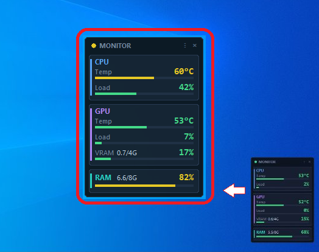

# pc-vitals-widget

A lightweight, standalone single-file HUD widget for Windows (`PCVitalsWidget.exe`, < 1 MB) that displays real-time **CPU**, **GPU**, **VRAM**, and **RAM** vitals in the corner of your screen.


-0078D6?style=flat-square)
-512BD4?style=flat-square)



---

## Features

- **Single-File Standalone Executable (`PCVitalsWidget.exe`)**
  - **Under 1 MB** (~960 KB) with `LibreHardwareMonitorLib.dll` and `HidSharp.dll` embedded directly inside the binary.
  - **Zero installation required:** runs out of the box on any Windows 10/11 PC using the built-in .NET Framework 4.7.2+ runtime.
  - **Built-in UAC Manifest:** automatically requests Administrator privileges on launch so CPU thermal MSR sensors work immediately with no wrapper scripts or console windows.
- **Real-Time Hardware Telemetry**
  - **CPU:** Package/core temperature (`°C`) and utilization (`%`) with individual progress bars.
  - **GPU:** Core/edge temperature (`°C`), utilization (`%`, including D3D 3D/Copy/Video engines for accurate idle & light-load readings), and dedicated **VRAM** (`GB` + `%`).
  - **RAM:** Used/total physical memory (`GB`) and utilization (`%`) via native Windows `GlobalMemoryStatusEx`.
- **Clean Floating HUD Design**
  - Borderless, anti-aliased rounded-corner dark overlay that stays on top without appearing in `Alt+Tab` or cluttering the taskbar.
  - Distinct grouped sub-cards for **CPU**, **GPU**, and **RAM** with color-coded left accent bars.
  - Dynamic thermal and load color indicators (green → yellow → orange → red).
  - **Normal** and **Compact** display modes.
- **Broad Hardware Support**
  - Powered by [LibreHardwareMonitorLib](https://github.com/LibreHardwareMonitor/LibreHardwareMonitor) — supports Intel and AMD CPUs as well as AMD, NVIDIA, and Intel GPUs.
- **Persistent Settings**
  - Automatically saves your preferred screen corner or custom position, opacity, compact mode, and always-on-top state in `config.json`.

---

## Quick Start

[-2EA043?style=for-the-badge)](https://github.com/felipematheuslo/pc-vitals-widget/raw/main/PCVitalsWidget.exe)

1. Download **[`PCVitalsWidget.exe`](https://github.com/felipematheuslo/pc-vitals-widget/raw/main/PCVitalsWidget.exe)** (or from the [Releases](https://github.com/felipematheuslo/pc-vitals-widget/releases) page).
2. Double-click **`PCVitalsWidget.exe`** and accept the Windows UAC Administrator prompt.

> `PCVitalsWidget.exe` is **100% standalone** — all required libraries are embedded inside the single `.exe` file, so you can place it directly on your Desktop or any folder and run it without installing anything.

<details>
<summary><sub>Alternatively: clone the repository via Git</sub></summary>

```bash
git clone https://github.com/felipematheuslo/pc-vitals-widget.git
cd pc-vitals-widget
.\PCVitalsWidget.exe
```
</details>

---

## Controls & Customization

| Action | Behavior |
| --- | --- |
| **Left-click & drag** | Move the widget anywhere on screen (position is saved in `config.json`) |
| **Double-click** | Toggle between **Normal** and **Compact** mode |
| **Right-click** (or click `⋮`) | Open the settings menu (screen corner, opacity, compact mode, always on top, close) |
| **Click `×`** or press **`Esc`** | Close the widget |

### Color Thresholds

| Status | Temperature (`°C`) | Usage (`%`) |
| --- | --- | --- |
| Green | `< 60°C` | `< 70%` |
| Yellow | `60°C – 74°C` | `70% – 84%` |
| Orange | `75°C – 84°C` | `85% – 94%` |
| Red | `≥ 85°C` | `≥ 95%` |

---

## Project Structure

```text
pc-vitals-widget/
├── PCVitalsWidget.exe           # Standalone single-file executable (< 1 MB)
├── build.ps1                    # One-step build script using built-in Windows csc.exe
├── config.json                  # Auto-generated user preferences (gitignored)
├── .gitignore
├── README.md
├── assets/
│   └── preview.png              # Desktop preview screenshot
├── src/
│   ├── Program.cs               # WinForms HUD overlay & hardware sensor loop
│   └── app.manifest             # Win32 DPI-awareness & UAC Administrator manifest
└── lib/
    ├── LibreHardwareMonitorLib.dll
    └── HidSharp.dll
```

---

## Building from Source

No Visual Studio, Python, or external SDK installation is required — `build.ps1` compiles `PCVitalsWidget.exe` using the C# compiler (`csc.exe`) pre-installed with Windows 10/11 and embeds `lib/*.dll` as manifest resources:

```powershell
.\build.ps1
```

---

## Acknowledgments

- Hardware sensor polling is powered by [LibreHardwareMonitor](https://github.com/LibreHardwareMonitor/LibreHardwareMonitor) (MPL-2.0) and [HidSharp](https://www.zer7.com/software/hidsharp).
